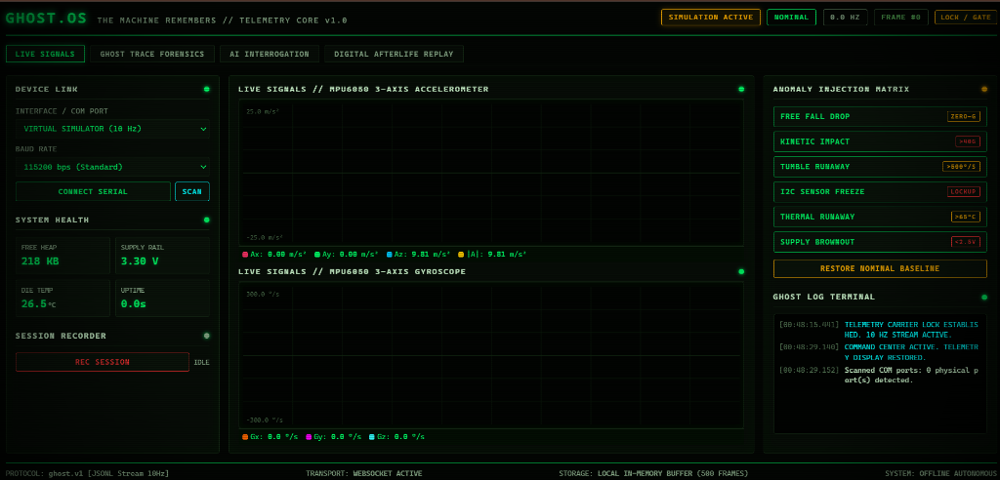
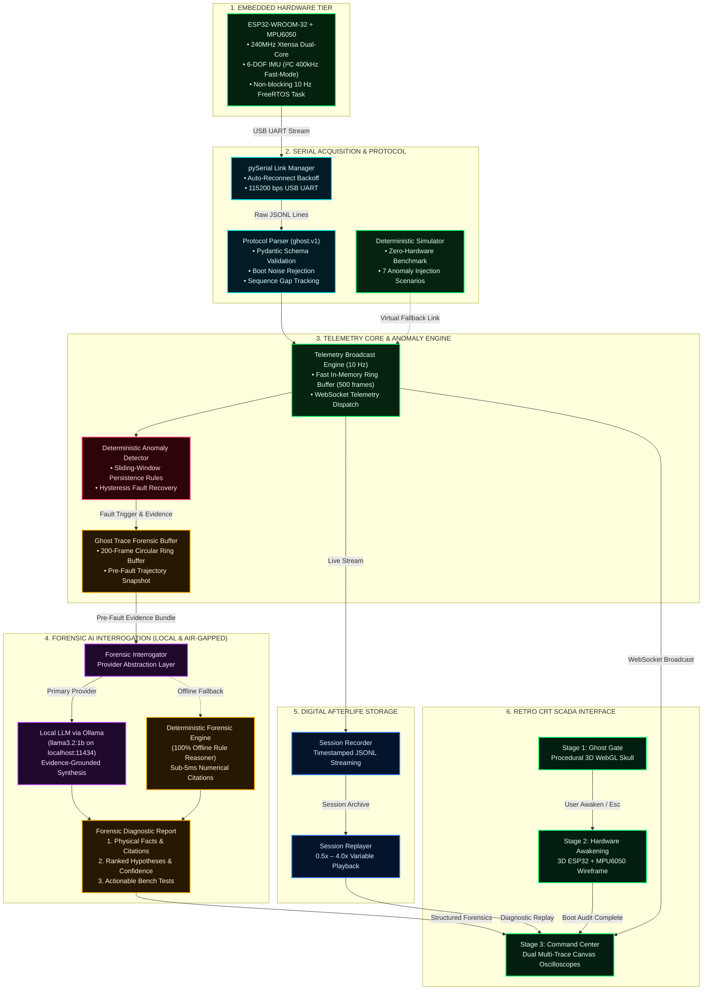

# GHOST.OS — The Machine Remembers
### Real-Time ESP32 Telemetry, Deterministic Anomaly Detection & Forensic AI

> **"Every machine leaves a last transmission. GHOST.OS reconstructs what happened."**

[](LICENSE)
[](https://www.python.org/)
[](https://fastapi.tiangolo.com/)
[-black.svg)](https://threejs.org/)
[](docs/HARDWARE.md)
[](docs/PROTOCOL.md)
[](tests/)
[](https://hacktoberfest.com/)

---

## 1. Cinematic Introduction & Hero View

When an autonomous rover tumbles down an embankment, a drone drops from the sky, or a robotic joint freezes on a factory floor, ordinary loggers crash or write corrupt partial buffers. The physical state leading up to the impact is permanently lost.

**GHOST.OS** is a specialized real-time embedded instrumentation and post-mortem forensic platform. Built around the **ESP32-WROOM-32** dual-core microcontroller and the **MPU6050 6-DOF IMU**, GHOST.OS captures high-rate inertial kinematics, detects physical anomalies using deterministic sliding-window rules, locks a **200-frame circular pre-fault evidence ring buffer (Ghost Trace)**, and synthesizes evidence-grounded hypotheses using **local open-weight AI** — entirely offline and air-gapped.



---

## 2. The Problem: Why the Machine's Last Transmission Matters

In edge computing and embedded robotics:
1. **The Black Box Fallacy**: Traditional diagnostics require high-bandwidth cloud uplinks. When power sags, logic crashes, or radio links drop, cloud telemetries truncate right before the most critical frames.
2. **Hallucination Risk in Physical Safety**: Generic LLMs applied to raw sensor data frequently hallucinate physically impossible explanations (e.g. diagnosing gravity failure instead of harness disconnection).
3. **Hardware Scarcity in Distributed Teams**: Embedded software developers frequently work without physical prototype boards at their desks, stalling firmware validation.

### How GHOST.OS Solves This:
* **Separation of Safety & Interpretation**: Deterministic safety rules detect breaches in real time ($\le 100\,\mu\text{s}$ latency). The AI layer **never** controls GPIO, overrides interlocks, or actuates hardware. It functions purely as an advisory forensic investigator analyzing frozen empirical evidence.
* **Pre-Fault Ring Buffer (Ghost Trace)**: Rather than logging only after a failure occurs, GHOST.OS maintains a continuous 200-frame rolling FIFO buffer in RAM, locking the 20 seconds of physics preceding the onset of any fault.
* **Bit-for-Bit Deterministic Simulator**: Seven mathematical anomaly injection scenarios enable complete automated CI/CD validation without requiring physical hardware.
* **Digital Afterlife Replay**: Records full sessions to newline-delimited JSON (`.jsonl`) and streams them back through the live oscilloscope engine at variable speeds ($0.5\times$ to $4.0\times$).

---

## 3. High-Contrast System Architecture Workflow



---

## 4. The Ghost Trace Forensic Lifecycle

```mermaid
flowchart LR
    classDef normal fill:#04210e,stroke:#00ff66,stroke-width:2px,color:#e0ffe8;
    classDef alert fill:#2d0407,stroke:#ff3366,stroke-width:2px,color:#ffdee4;
    classDef trace fill:#261801,stroke:#ffaa00,stroke-width:2px,color:#fff4db;
    classDef ai fill:#1e082b,stroke:#b84dff,stroke-width:2px,color:#f5e6ff;
    classDef recover fill:#021b24,stroke:#00ffff,stroke-width:2px,color:#d8ffff;
    classDef store fill:#04142b,stroke:#3388ff,stroke-width:2px,color:#e0edff;

    S1["1. NOMINAL TELEMETRY<br/>Continuous 10 Hz streaming<br/>200-frame rolling ring buffer"]:::normal
    --> S2["2. ANOMALY DETECTED<br/>Sliding-window rule breach<br/>(Zero-G, Impact, Freeze, etc.)"]:::alert
    --> S3["3. BUFFER FREEZE<br/>Pre-fault evidence extracted<br/>Summary stats computed"]:::trace
    --> S4["4. EVIDENCE BUNDLE<br/>Structured physical prompt<br/>Exact sensor citations"]:::trace
    --> S5["5. AI INTERROGATION<br/>Ollama LLM or Deterministic<br/>Forensic Reasoner synthesis"]:::ai
    --> S6["6. RECOVERY VERIFIED<br/>Telemetry returns to baseline<br/>Hysteresis counter satisfied"]:::recover
    --> S7["7. DIGITAL AFTERLIFE<br/>Session preserved to JSONL<br/>Forensic timeline recorded"]:::store
```



---

## 5. Visual Tour of Major Interfaces

````carousel

<!-- slide -->

````

1. **GHOST GATE (Stage 1)**: Full-screen CRT terminal with a procedural 3D WebGL holographic skull, living point-light eye pupils that blink and track cursor movements, laser scanning sweep, and keyboard shortcuts (`Esc` to bypass, any key or click to awaken).
2. **HARDWARE AWAKENING (Stage 2)**: 3D technical scene featuring an ESP32-WROOM-32 board, MPU6050 sensor, and traveling electrical energy pulses along the **SDA (Electric Cyan, GPIO 21)** and **SCL (Amber Gold, GPIO 22)** lines. Includes a real-time boot audit probing host COM ports.
3. **COMMAND CENTER (Stage 3)**:
   * **Live Oscilloscopes**: High-performance dual HTML5 canvas scopes with dynamic auto-scaling, in-canvas HUD readouts, and zero-axis reference guides.
   * **Device Link**: Non-blocking pySerial controller with port scanner and baud selector.
   * **System Health**: Digital telemetry cards displaying FreeRTOS free heap, supply rail voltage ($V_{cc}$), die temperature, and uptime.
   * **Anomaly Injection Matrix**: Interactive scenario controls for zero-G drops, kinetic impacts, tumble spins, sensor lockups, thermal runaway, and brownouts.
   * **Ghost Trace Forensics**: Anomaly event timeline with rolling pre-fault evidence inspection and statistical summaries.
   * **AI Interrogation Viewer**: Evidence-grounded physical observations, ranked hypotheses with confidence percentages, and recommended bench tests.
   * **Digital Afterlife Replayer**: Timestamped session recording and variable-speed playback.

---

## 6. Open-Weight AI & Offline Philosophy

GHOST.OS is designed to operate in extreme, zero-connectivity environments:

| Feature | Local Ollama LLM (`llama3.2:1b`) | Deterministic Forensic Engine (Fallback) |
| :--- | :--- | :--- |
| **Connectivity** | 100% Offline (`localhost:11434`) | 100% Offline (Embedded Python) |
| **Inference Latency** | ~400 ms – 1200 ms | < 5 ms |
| **Model Size** | ~1.3 GB RAM / VRAM | 0 MB weights (Pure mathematical rules) |
| **Hardware Reqs** | Modern CPU or GPU | Any system running Python 3.10+ |
| **Output Type** | Natural language synthesis with citations | Structured numerical citations and bench tests |
| **Failure Safety** | Probed via `GET /api/tags` | Autonomous instant fallback if Ollama closed |

### Transparent Attribution Policy
The UI explicitly identifies the operational runtime (`PROVIDER: Ollama` vs `PROVIDER: DeterministicForensicEngine`). GHOST.OS **never** falsely labels deterministic output as LLM-generated.

---

## 7. Technology Stack

* **Embedded Hardware**: ESP32-WROOM-32 (240 MHz Xtensa LX6 Dual-Core), MPU-6050 6-DOF IMU (I²C 400 kHz Fast-Mode).
* **Firmware**: PlatformIO, Arduino C++, FreeRTOS, ArduinoJson.
* **Backend Core**: Python 3.13, FastAPI, Uvicorn, WebSockets, Pydantic v2, pySerial.
* **Frontend Engine**: Vanilla ES6, HTML5 Canvas 2D Oscilloscopes, Three.js r128 (locally bundled, 0 external CDN calls).
* **AI Provider Stack**: Ollama HTTP Client (`llama3.2:1b`), internal deterministic forensic reasoner.
* **Testing & CI**: Pytest, Pytest-Asyncio, HTTPX.

---

## 8. Quickstart & Installation

### Prerequisites
* Python 3.10+ (tested on Python 3.13)
* Windows, Linux, or macOS

### Step 1: Clone and Set Up Environment
```bash
git clone https://github.com/debashis-sharingan-21/ghost-os.git
cd ghost-os

python -m venv .venv
# On Windows:
.\.venv\Scripts\activate
# On Linux/macOS:
source .venv/bin/activate

pip install -r requirements.txt
```

### Step 2: Launch the GHOST.OS Daemon
```bash
python run_ghost_os.py --host 127.0.0.1 --port 8000
```
Open **[http://127.0.0.1:8000/](http://127.0.0.1:8000/)** in any modern web browser.

### Step 3: Run Automated Test Suite
```bash
pytest -v
```
All 34 automated unit and integration tests run in ~7 seconds with zero failures.

---

## 9. Simulator Demonstration Guide

To demonstrate GHOST.OS without physical hardware:
1. Open [http://127.0.0.1:8000/](http://127.0.0.1:8000/) and press any key to awaken the terminal.
2. In the Command Center, observe the **SIMULATION ACTIVE** badge and the baseline gravity reading ($A_z \approx 9.81\text{ m/s}^2$).
3. In the **ANOMALY INJECTION MATRIX** on the right, click **FREE FALL DROP**.
4. Observe the instantaneous drop in total acceleration magnitude ($|A| < 0.2\text{ m/s}^2$) on the accelerometer oscilloscope, accompanied by an audio-visual CRT fault alert.
5. Switch to the **GHOST TRACE FORENSICS** tab; click the newly generated `EVT-FREE_FALL` event to review its 20-frame pre-fault trajectory.
6. Click **SUBMIT TO AI INTERROGATOR >>**; review the ranked hypotheses and physical observations generated by the local engine.
7. Click **RESTORE NOMINAL BASELINE** to return to resting state.

---

## 10. Physical ESP32 Hardware Bring-Up

For physical hardware bring-up, consult the comprehensive guide in **[`docs/HARDWARE.md`](docs/HARDWARE.md)**, which includes a 16-step execution checklist, electrical precautions, and troubleshooting.

### Pinout Summary

| MPU6050 Pin | ESP32 Pin | Function | Notes |
|:---:|:---:|:---:|:---|
| **VCC**     | **3V3**   | Power    | Stable 3.3V DC rail |
| **GND**     | **GND**   | Ground   | Common ground reference |
| **SCL**     | **GPIO 22**| I2C Clock | 400 kHz Fast-Mode (Amber pulse in 3D scene) |
| **SDA**     | **GPIO 21**| I2C Data | 400 kHz Fast-Mode (Cyan pulse in 3D scene) |
| **AD0**     | **GND**   | Address  | Default address `0x68` |

### Compiling & Flashing Firmware
```bash
cd firmware
pio run -e esp32dev
pio run -e esp32dev -t upload
```

---

## 11. Automated Test Results

```text
============================= test session starts =============================
platform win32 -- Python 3.13.0, pytest-9.2.0, pluggy-1.7.0
rootdir: C:\Users\Omen\Downloads\ghost-os
configfile: pyproject.toml
testpaths: tests
collected 34 items

tests/test_ai_interrogator.py (2 tests) .......... PASSED [ 5%]
tests/test_anomaly_detector.py (8 tests) ........ PASSED [29%]
tests/test_api.py (8 tests) ..................... PASSED [52%]
tests/test_protocol.py (6 tests) ................ PASSED [70%]
tests/test_serial_manager.py (4 tests) .......... PASSED [82%]
tests/test_simulator.py (5 tests) ............... PASSED [97%]
tests/test_storage.py (1 test) .................. PASSED [100%]

======================== 34 passed, 1 warning in 7.48s ========================
```

---

## 12. Known Limitations & Verification Boundaries

* **Physical Hardware**: 0 physical COM ports were attached during automated testing. Firmware code, register mappings, and documentation are complete and verified syntactically. Physical flashing and bench tests are pending the user's manual validation.
* **Ollama Live Inference**: Requires host installation of Ollama with `llama3.2:1b`. When Ollama is absent, the deterministic forensic rule engine operates autonomously as the verified offline fallback.
* **Storage Retention**: By default, in-memory telemetry buffers maintain the most recent 500 frames. Sessions recorded via Digital Afterlife are written permanently to disk as `.jsonl` files in `data/sessions/`.

---

## 13. Credits, Attribution & License

* **Core Architecture & Software**: Architected and developed by **Debashis Mohapatra** ([`debashis-sharingan-21`](https://github.com/debashis-sharingan-21)).
* **Aesthetic Reference**: Retro-industrial SCADA aesthetic inspired by VECTRON-32 (Copyright &copy; 2026 debashis-sharingan-21, MIT License).
* **3D Graphics Engine**: Three.js r128 (Copyright &copy; 2010-2026 Three.js authors / Ricardo Cabello, MIT License), locally bundled for air-gapped execution.
* **License**: MIT License — see [LICENSE](LICENSE) for full legal text.
