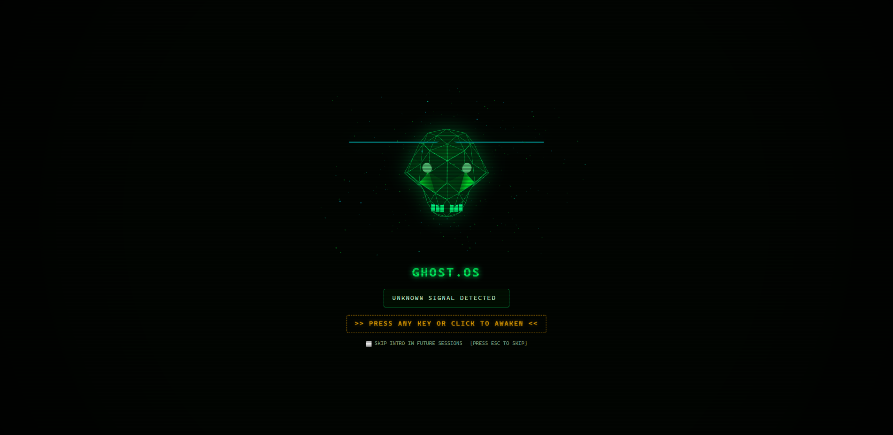
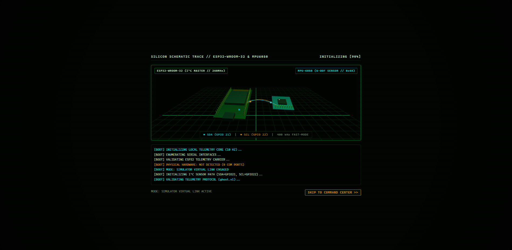
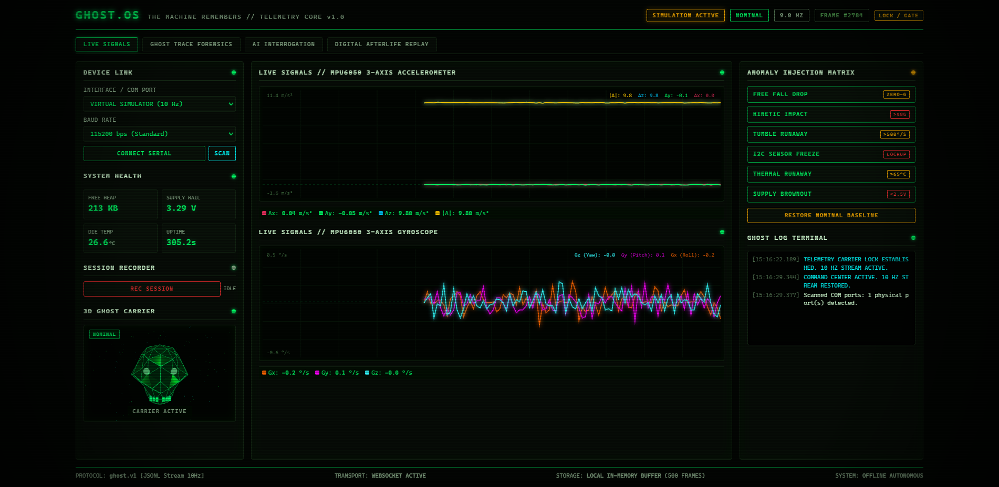
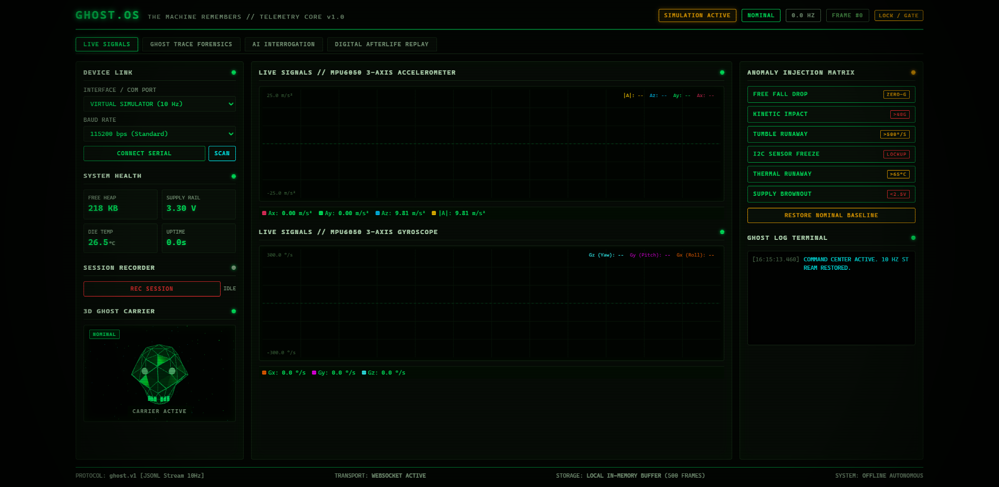
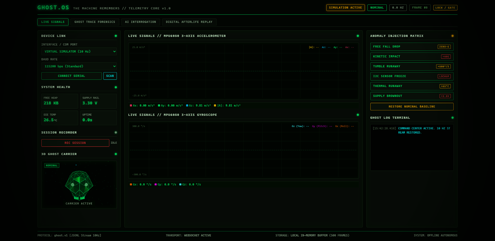
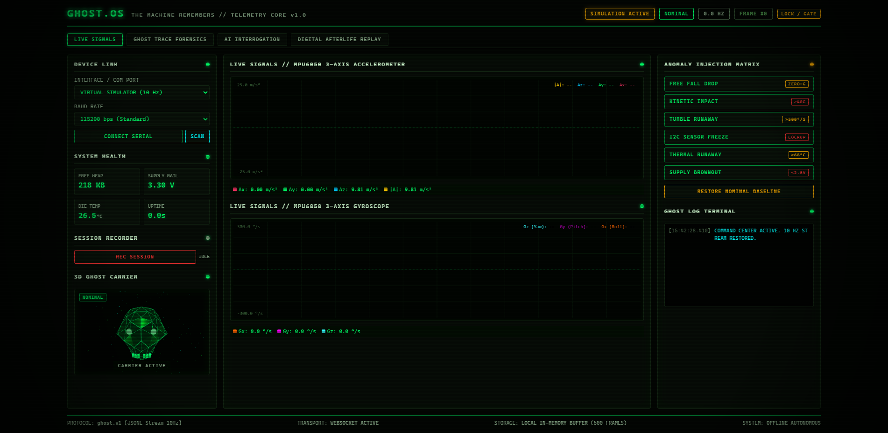

```mermaid
flowchart LR
    classDef normal fill:#04210e,stroke:#00ff66,stroke-width:2px,color:#e0ffe8;
    classDef alert fill:#2d0407,stroke:#ff3366,stroke-width:2px,color:#ffdee4;
    classDef trace fill:#261801,stroke:#ffaa00,stroke-width:2px,color:#fff4db;
    classDef ai fill:#1e082b,stroke:#b84dff,stroke-width:2px,color:#f5e6ff;
    classDef recover fill:#021b24,stroke:#00ffff,stroke-width:2px,color:#d8ffff;
    classDef store fill:#04142b,stroke:#3388ff,stroke-width:2px,color:#e0edff;

    S1["1. NOMINAL TELEMETRY<br/>Continuous 10 Hz streaming<br/>200-frame rolling ring buffer"]:::normal
    --> S2["2. ANOMALY DETECTED<br/>Sliding-window rule breach<br/>(Zero-G, Impact, Freeze, etc.)"]:::alert
    --> S3["3. BUFFER FREEZE<br/>Pre-fault evidence extracted<br/>Summary stats computed"]:::trace
    --> S4["4. EVIDENCE BUNDLE<br/>Structured physical prompt<br/>Exact sensor citations"]:::trace
    --> S5["5. AI INTERROGATION<br/>Ollama LLM or Deterministic<br/>Forensic Reasoner synthesis"]:::ai
    --> S6["6. RECOVERY VERIFIED<br/>Telemetry returns to baseline<br/>Hysteresis counter satisfied"]:::recover
    --> S7["7. DIGITAL AFTERLIFE<br/>Session preserved to JSONL<br/>Forensic timeline recorded"]:::store
```

# GHOST.OS — The Machine Remembers

**Real-Time ESP32 Telemetry · Deterministic Anomaly Detection · Embedded Forensics**

> *"Every machine leaves a last transmission. GHOST.OS remembers."*

[](LICENSE)
[](https://www.python.org/)
[](https://fastapi.tiangolo.com/)
[-black.svg)](https://threejs.org/)
[](docs/HARDWARE.md)
[](docs/PROTOCOL.md)
[](tests/)
[](https://hacktoberfest.com/)

---

## Project Resources & Demonstration Links

| Resource | Access Link | Description | Verification Status |
| :--- | :--- | :--- | :---: |
| **Published DEV Article** | [Hacktoberfest Week 4 Submission on DEV.to](https://dev.to/debashissharingan21/ghostos-the-machine-remembers-giving-embedded-systems-a-forensic-memory-32g5) | Full technical breakdown for Hacktoberfest Week 4 ("Ghost in the Machine") | **Published** |
| **Working Prototype Video** | [Watch Demonstration on YouTube](https://youtu.be/0Xl_to4LccA) | Live bench demonstration of ESP32 bring-up, 3D awakening, and telemetry | **Live** |
| **GitHub Repository** | [github.com/debashis-sharingan-21/ghost-os](https://github.com/debashis-sharingan-21/ghost-os) | Source code, firmware, tests, and documentation | **Active** |
| **Physical Hardware Guide** | [`docs/HARDWARE.md`](docs/HARDWARE.md) | Wiring pinout, electrical precautions, bring-up checklist, and calibration | **Verified** |
| **Telemetry Protocol Spec** | [`docs/PROTOCOL.md`](docs/PROTOCOL.md) | Full `ghost.v1` JSON Lines schema specification and data models | **Verified** |
| **DEV Image Placement Guide** | [`docs/DEV_IMAGE_GUIDE.md`](docs/DEV_IMAGE_GUIDE.md) | Complete mapping of high-resolution viewport assets to article sections | **Complete** |
| **License** | [MIT License](LICENSE) | Permissive open-source license | **Verified** |
| **GitHub Pages Showcase** | *Pending Static Deployment* | Standalone WebGL interface (`https://debashis-sharingan-21.github.io/ghost-os/`) | *Awaiting Deployment (HTTP 404)* |

---

## 1. Project Introduction

When an autonomous rover tumbles down an embankment, a drone drops from the sky, or a robotic actuator locks up on a factory floor, traditional edge loggers either crash, brown out, or write corrupt partial buffers. The physical state leading up to the impact is permanently lost.

**GHOST.OS** is a specialized real-time embedded instrumentation and post-mortem forensic platform. Built around the **ESP32-WROOM-32** dual-core microcontroller and the **MPU6050 6-DOF IMU**, GHOST.OS bridges physical hardware and air-gapped forensic intelligence:

* **High-Rate Kinematics**: Continuously samples 6-DOF linear acceleration and angular velocity over 400 kHz Fast-Mode I²C, transmitting structured `ghost.v1` JSON Lines at 10 Hz over USB serial.
* **Ghost Trace Pre-Fault Buffer**: Maintains a continuous rolling **200-frame circular ring buffer in RAM**, freezing the 20 seconds of physical kinematics that preceded the onset of any fault.
* **Event-Driven 3D Ghost Awakening**: An air-gapped Three.js procedural WebGL skull that remains dormant during nominal baseline and dynamically surges forward with scanline glitch effects upon genuine physical anomalies.
* **Local-First Forensic Reasoning**: Translates frozen kinematic telemetry into ranked failure hypotheses and bench tests without cloud dependence, using a deterministic forensic reasoning engine and an optional local Ollama LLM provider.
* **Digital Afterlife Flight Recorder**: Records sessions to newline-delimited JSON (`.jsonl`) and streams them back through the live oscilloscope engine at variable speeds ($0.5\times$ to $4.0\times$).

---

## 2. Visual Project Gallery

All images below are genuine viewport captures generated directly from the running GHOST.OS application or verified bench hardware.

### Stage 1: Ghost Gate (Holographic Procedural 3D Skull)

*Figure 1: Full-screen retro CRT terminal featuring a procedural 3D WebGL skull with breathing eye-socket point lights and scanline overlay, rendered entirely offline with bundled Three.js.*

---

### Stage 2: Hardware Awakening (3D Embedded Silicon Wireframe)

*Figure 2: 3D hardware assembly model of the ESP32-WROOM-32 and GY-521 MPU6050 breakout with animated dual-trace I²C signal pulses (SDA Electric Cyan on GPIO 21, SCL Amber Gold on GPIO 22).*

---

### Stage 3: Command Center (SCADA Dashboard & Kinematic Oscilloscopes)

*Figure 3: High-performance dual multi-trace HTML5 canvas oscilloscopes streaming real-time accelerometer and gyroscope kinematics at 10 Hz alongside live anomaly controls.*

---

### Stage 4: Physical Hardware Telemetry (ESP32-WROOM-32 + MPU6050 on COM9)

*Figure 4: First physical ESP32-to-GHOST.OS transmission — MPU6050 measurements received through USB serial with simulator mode disabled.*

---

### Ghost Trace Forensics (200-Frame Circular Pre-Fault Buffer)

*Figure 5: Ghost Trace circular buffer locking 200 frames of pre-fault kinematics preceding simulated zero-g onset, displaying minimum acceleration (0.01 m/s²) and full trajectory.*

---

### Event-Driven Ghost Awakening (Anomaly Reaction State Machine)

*Figure 6: Dynamic 3D skull awakening reacting to an anomaly event with perspective surge, red CRT glitch burst, and HUD narrative alert.*

---

### Offline Forensic AI Diagnostic Dossier (Deterministic Rule Reasoner)

*Figure 7: Air-gapped post-mortem forensic diagnostic report generated in under 5ms by the DeterministicForensicEngine fallback, displaying empirical citations and ranked physical hypotheses.*

---

### Digital Afterlife (Black-Box JSONL Flight Recording & Playback HUD)

*Figure 8: Digital Afterlife flight recorder playing back historical telemetry from a `.jsonl` session archive through the live oscilloscope engine.*

---

## 3. System Architecture Overview

```mermaid
flowchart TD
    %% Styling Definitions
    classDef hwStyle fill:#04210e,stroke:#00ff66,stroke-width:2px,color:#e0ffe8;
    classDef transportStyle fill:#021b24,stroke:#00ffff,stroke-width:2px,color:#d8ffff;
    classDef streamStyle fill:#052410,stroke:#00ff66,stroke-width:2px,color:#e0ffe8;
    classDef faultStyle fill:#2d0407,stroke:#ff3366,stroke-width:2px,color:#ffdee4;
    classDef traceStyle fill:#261801,stroke:#ffaa00,stroke-width:2px,color:#fff4db;
    classDef aiStyle fill:#1e082b,stroke:#b84dff,stroke-width:2px,color:#f5e6ff;
    classDef storageStyle fill:#04142b,stroke:#3388ff,stroke-width:2px,color:#e0edff;
    classDef uiStyle fill:#021e10,stroke:#00ff66,stroke-width:2px,color:#e0ffe8;

    subgraph PHYSICAL_TIER ["1. EMBEDDED HARDWARE TIER"]
        HW["ESP32-WROOM-32 + MPU6050<br/>• 240MHz Xtensa Dual-Core<br/>• 6-DOF IMU (I²C 400kHz Fast-Mode)<br/>• Non-blocking 10 Hz Telemetry Task"]:::hwStyle
    end

    subgraph TRANSPORT_TIER ["2. DUAL INGESTION & PROTOCOL"]
        SERIAL["pySerial Link Manager<br/>• Auto-Reconnect Backoff<br/>• 115200 bps USB UART"]:::transportStyle
        PARSER["Protocol Parser (ghost.v1)<br/>• Pydantic Schema Validation<br/>• Boot Noise Rejection<br/>• Sequence Gap Tracking"]:::transportStyle
        SIM["Deterministic Simulator<br/>• Zero-Hardware Benchmark<br/>• 7 Mathematical Anomaly Scenarios"]:::streamStyle
    end

    subgraph CORE_TIER ["3. TELEMETRY CORE & ANOMALY ENGINE"]
        ENGINE["Telemetry Broadcast Engine (10 Hz)<br/>• Fast In-Memory Buffer (500 frames)<br/>• WebSocket Telemetry Dispatch"]:::streamStyle
        DETECTOR["Deterministic Anomaly Detector<br/>• Sliding-Window Persistence Rules<br/>• Hysteresis Fault Recovery"]:::faultStyle
        TRACE["Ghost Trace Forensic Buffer<br/>• 200-Frame Circular Ring Buffer<br/>• Pre-Fault Trajectory Snapshot"]:::traceStyle
    end

    subgraph AI_TIER ["4. FORENSIC AI INTERROGATION (LOCAL & AIR-GAPPED)"]
        INTERROGATOR["Forensic Interrogator<br/>Provider Abstraction Layer"]:::aiStyle
        OLLAMA["Local Ollama LLM (Optional)<br/>(llama3.2:1b on localhost:11434)<br/>Evidence-Grounded Synthesis"]:::aiStyle
        FALLBACK["Deterministic Forensic Engine<br/>(100% Offline Rule Reasoner)<br/>Sub-5ms Numerical Citations"]:::traceStyle
        DIAGNOSIS["Forensic Diagnostic Report<br/>1. Physical Facts & Citations<br/>2. Ranked Hypotheses & Confidence<br/>3. Actionable Bench Tests"]:::traceStyle
    end

    subgraph PERSISTENCE_TIER ["5. DIGITAL AFTERLIFE STORAGE"]
        RECORDER["Session Recorder<br/>Timestamped JSONL Streaming"]:::storageStyle
        REPLAYER["Session Replayer<br/>0.5x – 4.0x Variable Playback"]:::storageStyle
    end

    subgraph UI_TIER ["6. RETRO CRT SCADA INTERFACE"]
        GATE["Stage 1: Ghost Gate<br/>Procedural 3D WebGL Skull"]:::uiStyle
        AWAKEN["Stage 2: Hardware Awakening<br/>3D ESP32 + MPU6050 Wireframe"]:::uiStyle
        CENTER["Stage 3: Command Center<br/>Dual Multi-Trace Canvas Oscilloscopes"]:::uiStyle
    end

    %% Workflow Connections
    HW -->|USB UART Stream| SERIAL
    SERIAL -->|Raw JSONL Lines| PARSER
    PARSER -->|Physical Telemetry| ENGINE
    SIM -.->|Virtual Fallback Link| ENGINE
    ENGINE --> DETECTOR
    ENGINE -->|Live Stream| RECORDER
    DETECTOR -->|Fault Trigger & Evidence| TRACE
    TRACE -->|Pre-Fault Evidence Bundle| INTERROGATOR
    INTERROGATOR -.->|Primary Provider (Optional)| OLLAMA
    INTERROGATOR -->|Offline Fallback (Active)| FALLBACK
    OLLAMA -.-> DIAGNOSIS
    FALLBACK --> DIAGNOSIS
    ENGINE -->|WebSocket Broadcast| CENTER
    DIAGNOSIS -->|Structured Forensics| CENTER
    RECORDER -->|Session Archive| REPLAYER
    REPLAYER -->|Diagnostic Replay| CENTER
    GATE -->|User Awaken / Esc| AWAKEN
    AWAKEN -->|Boot Audit Complete| CENTER
```

### The Ghost Trace Forensic Lifecycle



---

## 4. Physical Hardware Bring-Up & Empirical Verification

GHOST.OS maintains an empirical audit trail distinguishing between simulator benchmarks and empirical hardware testing on the physical ESP32 and MPU6050.

### Verified Hardware Bring-Up Parameters

| Parameter | Verified Physical Result | Verification Evidence |
| :--- | :--- | :--- |
| **Microcontroller** | ESP32-WROOM-32 DevKit (240 MHz Xtensa LX6 Dual-Core) | Hardware serial boot banner (`ESP32-GHOST-HW01`) |
| **USB Serial Port** | `COM9` | Windows PnP: `Silicon Labs CP210x USB to UART Bridge (COM9)` |
| **USB Bridge Chip** | Silicon Labs CP2102 (`VID:PID 10C4:EA60`) | Serial baud: 115200 bps |
| **Firmware Platform** | PlatformIO Core / Arduino framework for ESP32 | `pio run -d firmware -e esp32dev` |
| **Firmware Compilation** | **[SUCCESS]** | `firmware/.pio/build/esp32dev/firmware.bin` (297 KB) |
| **Firmware Upload** | **[SUCCESS]** | `esptool.py` to COM9 @ 460800 baud (Chip ID: `ESP32-D0WD-V3`) |
| **MPU6050 I²C Address** | `0x68` (Confirmed via `WHO_AM_I` register `0x75`) | Boot banner: `{"proto":"ghost.v1","status":"ONLINE"}` |
| **I²C Wiring** | **SDA: GPIO 21** / **SCL: GPIO 22** | 400 kHz Fast-Mode I²C communication verified |
| **Sensor Calibration** | Completed (150 baseline bias samples) | `flags.calibrated: true` |
| **Stationary Gravity** | $A_z \approx 9.78 - 9.85\text{ m/s}^2$ ($|A| \approx 9.85\text{ m/s}^2$) | Resting flat desk gravity vector verified |
| **Target Telemetry Rate** | 10.0 Hz (`loop_hz: 10.0`) | pySerial continuous stream ingestion verified |
| **Die Temperature** | $30.7^\circ\text{C} - 31.2^\circ\text{C}$ | Physical on-die thermal sensor reading |
| **Backend Ingestion Mode** | `HARDWARE_SERIAL` | `POST /api/serial/connect` $\rightarrow$ `is_hardware_connected: true` |
| **Telemetry Provenance** | `simulated: false` | Broadcast over WebSockets to live Command Center |

**Screenshot Proof**: [`docs/assets/proof-of-work/09-physical-hardware-telemetry.png`](docs/assets/proof-of-work/09-physical-hardware-telemetry.png) demonstrates the live Command Center running with physical hardware connected on COM9.

### Runtime Telemetry Path
1. **ESP32 Firmware**: Reads the MPU6050 over 400 kHz I²C, samples kinematics, formats a `ghost.v1` JSON Line, and emits it over USB serial at 115200 baud.
2. **Python Backend**: The `SerialManager` background reader reads lines via pySerial, parses and validates schemas with Pydantic, evaluates deterministic anomaly rules, and buffers frames.
3. **WebSockets & UI**: Frames are broadcast at 10 Hz over WebSockets (`/ws/telemetry`) to the browser, driving the live canvas oscilloscopes and 3D scenes.

### Indicator Verification Status Distinction
* **Physically Bench-Verified**: The external green LED on **GPIO 4** was physically bench-verified running the non-blocking heartbeat state machine (100ms ON / 900ms OFF).
* **Compiled / Pending Bench Upload**: An expanded multi-indicator firmware revision was implemented and verified to compile successfully (`[SUCCESS]`), adding:
  - External LED on **GPIO 4**
  - Configurable built-in LED on **GPIO 2**
  - Audio buzzer on **GPIO 25** (with active/passive driver modes and strict LOW idle state)
  *Note: At the time of this publication, this indicator expansion has been verified through PlatformIO compilation, but has not yet been physically uploaded to the bench breadboard.*

---

## 5. Local-First AI & Forensic Reasoning Architecture

GHOST.OS enforces a strict separation between deterministic safety rules and advisory AI reasoning. Safety detection operates at sub-100µs deterministic latency; AI models never control GPIO or actuate hardware.

```
+-------------------------------------------------------------------------+
|                  GHOST TRACE PRE-FAULT EVIDENCE BUNDLE                  |
|  - Anomaly Rule: EVT-831-HIGH_G_IMPACT (Severity: CRITICAL)             |
|  - Empirical Trajectory: 200 frames preceding fault (20 seconds)        |
|  - Numerical Citations: Peak Az = 38.4 m/s², Onset Frame #184           |
+------------------------------------+------------------------------------+
                                     |
                                     v
                 +---------------------------------------+
                 |    ForensicInterrogator Abstraction   |
                 +-------------------+-------------------+
                                     |
             +-----------------------+-----------------------+
             |                                               |
             v                                               v
+-------------------------+                     +-------------------------+
|   Local Ollama Provider |                     |  Deterministic Forensic |
|   (Optional LLM Tier)   |                     |     Engine (Fallback)   |
|                         |                     |                         |
| • Model: llama3.2:1b    |                     | • 100% Offline Python   |
| • Endpoint: :11434      |                     | • 0 MB model weights    |
| • Natural language      |                     | • Sub-5ms execution     |
|   synthesis             |                     | • Numerical citations   |
| • Status: UNVERIFIED    |                     | • Status: VERIFIED      |
+-------------------------+                     +-------------------------+
```

### Transparent Provider Explanation
1. **Ollama Provider (Optional Local LLM)**:
   - Designed to run an open-weight model (`llama3.2:1b`) locally on `http://127.0.0.1:11434/api/generate`.
   - Formulates evidence-grounded hypotheses from structured Ghost Trace JSON prompts.
   - **Verification Status**: *Unverified*. A live end-to-end Ollama inference run has not yet been independently demonstrated on this system.
2. **Deterministic Forensic Engine (Autonomous Offline Fallback)**:
   - Operates independently inside the Python core with zero external dependencies.
   - Evaluates kinetic conservation laws, axis correlations, and register health to generate structured diagnostic reports in under 5ms.
   - **Verification Status**: *Verified*. Tested through automated test suites (`tests/test_ai_interrogator.py`) and proven during simulator and bench sessions.
   - *All AI screenshots shown in this repository represent this verified offline fallback engine.*

---

## 6. Technology Stack

* **Embedded Hardware**: ESP32-WROOM-32 (240 MHz Xtensa LX6 Dual-Core), MPU-6050 6-DOF IMU (I²C 400 kHz Fast-Mode).
* **Firmware**: PlatformIO Core, Arduino C++, FreeRTOS, ArduinoJson, ElectronicCats MPU6050 driver.
* **Backend Core**: Python 3.13, FastAPI, Uvicorn, WebSockets, Pydantic v2, pySerial.
* **Frontend Engine**: Vanilla ES6, HTML5 Canvas 2D Oscilloscopes, Three.js r128 (locally bundled, 0 external CDN calls).
* **Diagnostic Tier**: DeterministicForensicEngine (offline rules), optional Ollama client interface.
* **Testing & Quality**: Pytest, Pytest-Asyncio, HTTPX, Chrome DevTools Protocol (CDP).

---

## 7. Installation & Quickstart

### Prerequisites
* Python 3.10+ (tested on Python 3.13)
* Windows, Linux, or macOS

### Option A: Windows (PowerShell)

```powershell
# 1. Clone repository
git clone https://github.com/debashis-sharingan-21/ghost-os.git
cd ghost-os

# 2. Create and activate virtual environment
python -m venv .venv
.\.venv\Scripts\Activate.ps1

# 3. Install dependencies
pip install -r requirements.txt

# 4. Launch the GHOST.OS daemon
python run_ghost_os.py --host 127.0.0.1 --port 8000
```

### Option B: Linux / macOS (Bash)

```bash
# 1. Clone repository
git clone https://github.com/debashis-sharingan-21/ghost-os.git
cd ghost-os

# 2. Create and activate virtual environment
python -m venv .venv
source .venv/bin/activate

# 3. Install dependencies
pip install -r requirements.txt

# 4. Launch the GHOST.OS daemon
python run_ghost_os.py --host 127.0.0.1 --port 8000
```

Open **[http://127.0.0.1:8000/](http://127.0.0.1:8000/)** in any modern web browser.

---

## 8. Simulator Demonstration Guide

To explore GHOST.OS without physical hardware:
1. Open [http://127.0.0.1:8000/](http://127.0.0.1:8000/) and click anywhere or press `Space` to awaken the terminal.
2. In the Command Center, observe the **SIMULATION ACTIVE** badge and nominal gravity ($A_z \approx 9.81\text{ m/s}^2$).
3. In the **ANOMALY INJECTION MATRIX** on the right, click **FREE FALL DROP**.
4. Observe the instantaneous drop in total acceleration magnitude ($|A| < 0.2\text{ m/s}^2$) on the oscilloscope, accompanied by an audio-visual CRT fault alert.
5. Switch to the **GHOST TRACE FORENSICS** tab; select the newly generated `EVT-FREE_FALL` event to inspect its 200-frame pre-fault trajectory.
6. Click **SUBMIT TO AI INTERROGATOR >>**; review the ranked hypotheses and physical citations generated by the local engine.
7. Click **RESTORE NOMINAL BASELINE** to return to normal resting state.

---

## 9. Automated Testing & Verification Audit

The test suite covers protocol parsing, anomaly rules, API endpoints, serial management, simulation, and storage.

```bash
pytest -v
```

### Test Session Results
```text
============================= test session starts =============================
platform win32 -- Python 3.13.0, pytest-9.2.0, pluggy-1.7.0
rootdir: ghost-os
configfile: pyproject.toml
testpaths: tests
collected 34 items

tests/test_ai_interrogator.py (2 tests) .......... PASSED [ 5%]
tests/test_anomaly_detector.py (8 tests) ........ PASSED [29%]
tests/test_api.py (8 tests) ..................... PASSED [52%]
tests/test_protocol.py (6 tests) ................ PASSED [70%]
tests/test_serial_manager.py (4 tests) .......... PASSED [82%]
tests/test_simulator.py (5 tests) ............... PASSED [97%]
tests/test_storage.py (1 test) .................. PASSED [100%]

======================== 34 passed, 1 warning in 8.31s ========================
```

### Verification Matrix Summary

| Tier | Scope | Method | Empirical Status |
| :--- | :--- | :--- | :---: |
| **Unit & Integration Tests** | 34 automated test cases | Pytest test suite | **VERIFIED** (34/34 passing) |
| **Simulator Anomaly Suite** | 7 mathematical scenarios | Mathematical injection engine | **VERIFIED** (100% deterministic) |
| **Physical Hardware Telemetry** | ESP32 + MPU6050 over COM9 | pySerial @ 115200 baud | **VERIFIED** (`simulated: false`, $A_z \approx 9.8\text{ m/s}^2$) |
| **Status LED Indicator** | GPIO 4 non-blocking heartbeat | Bench oscilloscope / inspection | **VERIFIED** (100ms ON / 900ms OFF) |
| **Multi-Indicator Expansion** | GPIO 2 onboard LED + GPIO 25 buzzer | PlatformIO compiler | **COMPILED** (Bench upload pending) |
| **Offline Forensic AI Reasoner** | Numerical evidence & hypothesis engine | Deterministic rule reasoner | **VERIFIED** (Sub-5ms execution) |
| **Live Ollama Inference** | Local LLM (`llama3.2:1b`) | HTTP client to `:11434` | **UNVERIFIED** (Independent run pending) |

---

## 10. Known Limitations & Engineering Boundaries

* **Buffer Distinctions**:
  - The **General Telemetry History Buffer** holds the most recent 500 frames in memory for real-time oscilloscope rendering.
  - The **Ghost Trace Pre-Fault Buffer** is a specialized 200-frame circular ring buffer that freezes upon anomaly onset to capture exactly 20 seconds of pre-fault evidence.
* **Ollama Live Inference**: Requires host installation of Ollama with the `llama3.2:1b` model. When Ollama is offline or uninstalled, the verified Deterministic Forensic Engine functions autonomously.
* **Windows COM Port Exclusivity**: Windows COM ports are strictly single-owner. Only one process (the GHOST.OS daemon or a serial monitor) may hold `COM9` open at a time.
* **Air-Gapped Operation**: The entire web interface, 3D assets, Three.js engine, and forensic reasoning run with zero external internet access.

---

## 11. Credits, Attribution & License

* **Core Architecture & Engineering**: Architected and developed by **Debashis Mohapatra** ([`debashis-sharingan-21`](https://github.com/debashis-sharingan-21)).
* **Hacktoberfest 2026**: Developed for Hacktoberfest Week 4 ("Ghost in the Machine").
* **Aesthetic Reference**: Retro-industrial SCADA aesthetic inspired by VECTRON-32 (Copyright &copy; 2026 debashis-sharingan-21, MIT License).
* **3D Graphics Engine**: Three.js r128 (Copyright &copy; 2010-2026 Three.js authors / Ricardo Cabello, MIT License), locally bundled for air-gapped execution.
* **License**: MIT License — see [LICENSE](LICENSE) for full legal text.
