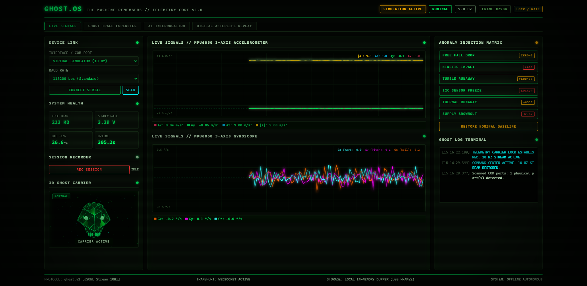
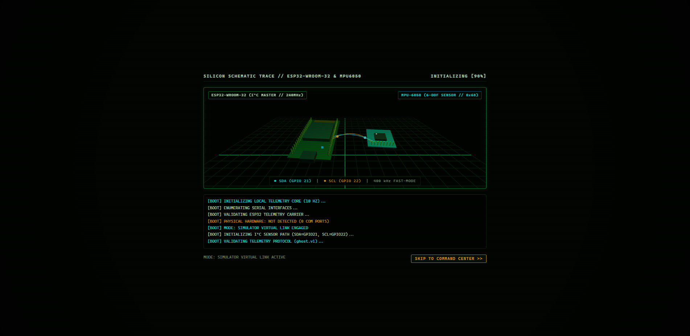
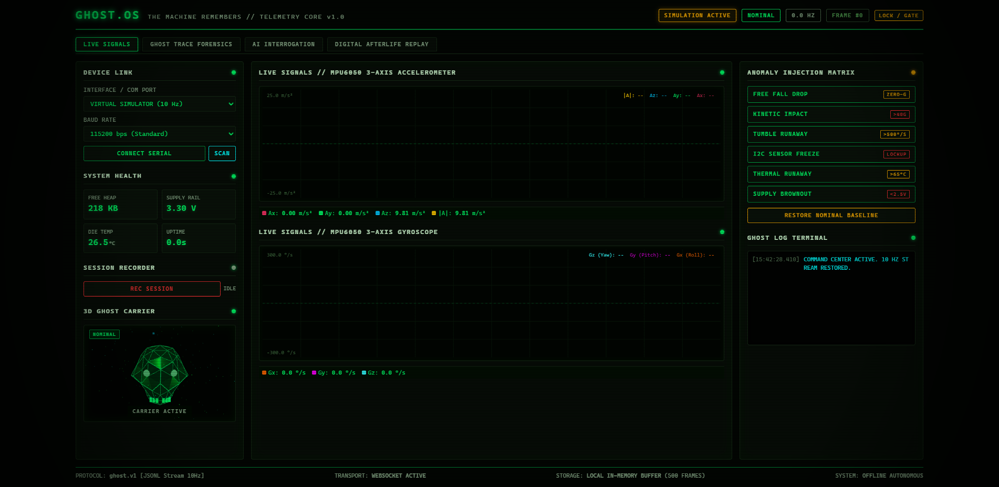
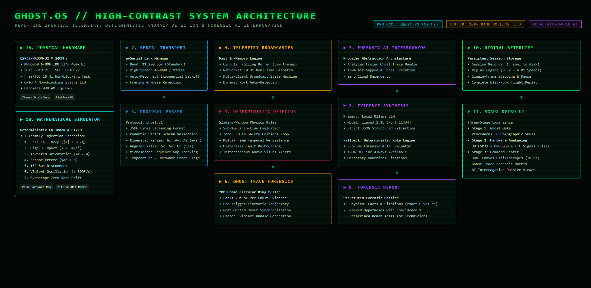
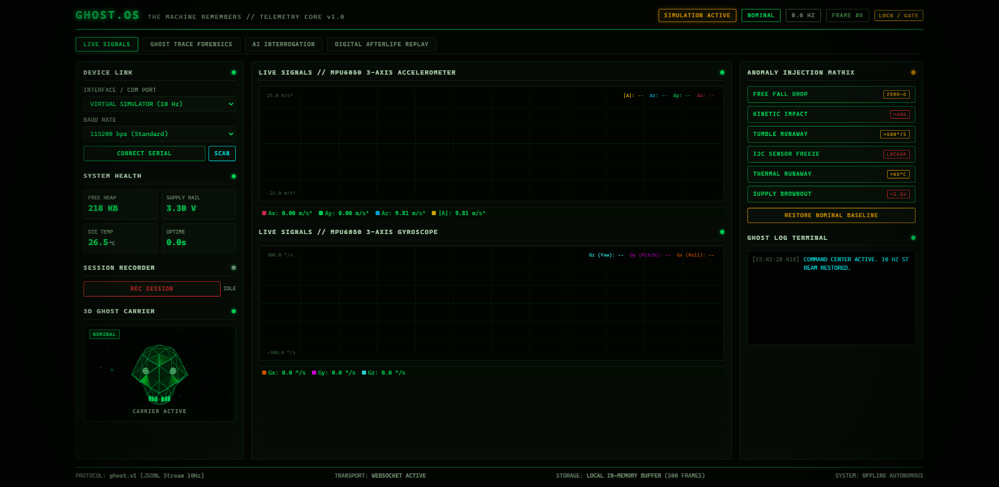
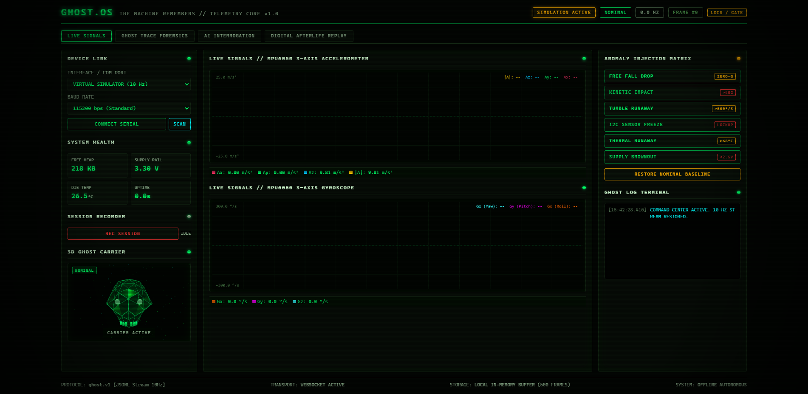
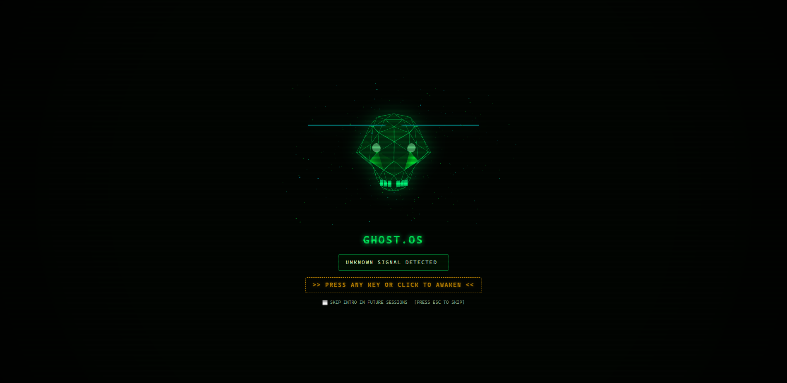

# GHOST.OS — DEV.to Article Visual Placement Guide

This guide maps each genuine visual asset in `docs/assets/proof-of-work/` to its recommended placement in [`docs/DEV_ARTICLE.md`](DEV_ARTICLE.md) for public submission.

All images are authentic, high-resolution viewport captures ($1902 \times 928$) generated directly from the running GHOST.OS application or its architecture specification. No mockups or AI-generated interface images are used.

---

## Master Image Placement Matrix

| File Name | Recommended DEV Article Section | Verification Status | Artifact Path |
| :--- | :--- | :---: | :--- |
| **`01-ghost-gate.png`** | Section 6: *Air-Gapped 3D Visual Experience* (Opening Hook) | **Software Tested** | [`docs/assets/proof-of-work/01-ghost-gate.png`](assets/proof-of-work/01-ghost-gate.png) |
| **`02-hardware-awakening.png`** | Section 1: *The Black Box Dilemma of the Edge* | **Software Tested** | [`docs/assets/proof-of-work/02-hardware-awakening.png`](assets/proof-of-work/02-hardware-awakening.png) |
| **`03-command-center.png`** | Hero Cover & Section 2: *Why the Machine's Last Transmission Matters* | **Software Tested** | [`docs/assets/proof-of-work/03-command-center.png`](assets/proof-of-work/03-command-center.png) |
| **`04-architecture.png`** | Section 4: *Why We Separate Deterministic Safety from AI Interpretation* | **Synthesized Diagram** | [`docs/assets/proof-of-work/04-architecture.png`](assets/proof-of-work/04-architecture.png) |
| **`05-ghost-trace.png`** | Section 3: *How Ghost Trace Reconstructs Faults* | **Software Tested** (Simulator Benchmark) | [`docs/assets/proof-of-work/05-ghost-trace.png`](assets/proof-of-work/05-ghost-trace.png) |
| **`06-ghost-awakening.png`** | Section 6: *Air-Gapped 3D Visual Experience* (Anomaly Reaction) | **Software Tested** (Simulator Visual Demo) | [`docs/assets/proof-of-work/06-ghost-awakening.png`](assets/proof-of-work/06-ghost-awakening.png) |
| **`07-forensic-report.png`** | Section 5: *Local Open-Weight AI & The Air-Gapped Philosophy* | **Software Tested** (Deterministic Fallback) | [`docs/assets/proof-of-work/07-forensic-report.png`](assets/proof-of-work/07-forensic-report.png) |
| **`08-digital-afterlife.png`** | Section 6: *What Was Technically Difficult* (Digital Afterlife) | **Software Tested** (Session Recording/Replay) | [`docs/assets/proof-of-work/08-digital-afterlife.png`](assets/proof-of-work/08-digital-afterlife.png) |

---

## Detailed Section Guide & Embed Snippets

### 1. Hero / Header & Section 2: Command Center
* **File**: `docs/assets/proof-of-work/03-command-center.png`
* **Target Section**: Immediately below title or inside Section 2 (*"Why the Machine's Last Transmission Matters"*).
* **Caption**: *"GHOST.OS Command Center: Dual multi-trace HTML5 canvas oscilloscopes streaming real-time accelerometer and gyroscope kinematics at 10 Hz alongside live anomaly injection controls."*
* **Markdown Embed**:
  ```markdown
  
  *Figure 1: GHOST.OS Command Center running in SCADA CRT retro theme with live 10 Hz kinematic oscilloscopes.*
  ```

---

### 2. Section 1: Embedded Hardware Wireframe
* **File**: `docs/assets/proof-of-work/02-hardware-awakening.png`
* **Target Section**: Section 1 (*"The Real Problem: The Black Box Dilemma of the Edge"*).
* **Caption**: *"Stage 2 Hardware Awakening: Real-time 3D models of ESP32-WROOM-32 and MPU6050 with animated dual-trace I²C signal pulses (SDA cyan GPIO 21, SCL amber GPIO 22) and live boot audit log."*
* **Markdown Embed**:
  ```markdown
  
  *Figure 2: 3D hardware assembly view rendering ESP32-WROOM-32 MCU, MPU6050 IMU, and 400kHz I²C fast-mode traces.*
  ```

---

### 3. Section 3: Ghost Trace Pre-Fault Buffer
* **File**: `docs/assets/proof-of-work/05-ghost-trace.png`
* **Target Section**: Section 3 (*"How Ghost Trace Reconstructs Faults"*).
* **Caption**: *"Ghost Trace Forensics Tab: 200-frame circular pre-fault evidence buffer locked upon simulated Free Fall detection, displaying minimum acceleration (0.01 m/s²), onset frame (#33), and full kinematic trajectory."*
* **Verification Note**: *Explicitly captures a simulator-injected Free Fall benchmark.*
* **Markdown Embed**:
  ```markdown
  
  *Figure 3: Ghost Trace circular buffer locking 20 seconds of pre-fault kinematics preceding simulated zero-g onset.*
  ```

---

### 4. Section 4: System Architecture Diagram
* **File**: `docs/assets/proof-of-work/04-architecture.png`
* **Target Section**: Section 4 (*"Why We Separate Deterministic Safety from AI Interpretation"*).
* **Caption**: *"GHOST.OS High-Contrast System Architecture: Dual telemetry ingestion (Physical ESP32 & Deterministic Simulator), pySerial transport, ghost.v1 JSONL protocol, deterministic anomaly detector, and local air-gapped forensic AI tier."*
* **Markdown Embed**:
  ```markdown
  
  *Figure 4: End-to-end architecture showing separation of sub-100µs deterministic safety rules from advisory forensic AI.*
  ```

---

### 5. Section 5: Air-Gapped AI Forensic Dossier
* **File**: `docs/assets/proof-of-work/07-forensic-report.png`
* **Target Section**: Section 5 (*"Local Open-Weight AI & The Air-Gapped Philosophy"*).
* **Caption**: *"Air-gapped post-mortem forensic diagnostic report generated in under 5ms by the DeterministicForensicEngine fallback, displaying empirical numerical citations, ranked physical hypotheses (94% Ballistic Descent), and prescribed bench tests."*
* **Verification Note**: *Explicitly identifies the provider as DeterministicForensicEngine offline fallback.*
* **Markdown Embed**:
  ```markdown
  
  *Figure 5: Forensic AI interrogation report grounded in numerical evidence citations with zero external cloud dependencies.*
  ```

---

### 6. Section 6: Digital Afterlife Black-Box Replay
* **File**: `docs/assets/proof-of-work/08-digital-afterlife.png`
* **Target Section**: Section 6 (*"What Was Technically Difficult"*).
* **Caption**: *"Digital Afterlife Replay HUD: Playback controls (0.5x to 4.0x), frame scrubber, and telemetry streaming from a saved JSONL session file."*
* **Markdown Embed**:
  ```markdown
  
  *Figure 6: Digital Afterlife flight recorder interface playing back historical telemetry through the live oscilloscope engine.*
  ```

---

### 7. Section 6: Holographic 3D Skull & Event Awakening
* **Files**:
  - `docs/assets/proof-of-work/01-ghost-gate.png`
  - `docs/assets/proof-of-work/06-ghost-awakening.png`
* **Target Section**: Section 6 (*"Air-Gapped 3D Visual Experience"*).
* **Caption**: *"Stage 1 Ghost Gate and dynamic 3D skull awakening reaction: Procedural WebGL holographic skull pulsing in dormant nominal state (left) and reacting with red CRT glitch burst and HUD narrative upon anomaly detection (right)."*
* **Verification Note**: *Demonstrates simulator-driven WebGL visual reaction state machine.*
* **Markdown Embed**:
  ```markdown
  
  *Figure 7A: Procedural 3D WebGL skull with breathing eye-socket point lights rendered entirely offline with bundled Three.js.*

  
  *Figure 7B: 3D Ghost Awakening event reaction triggering perspective surge, CRT scanline glitch, and HUD narrative alert.*
  ```
